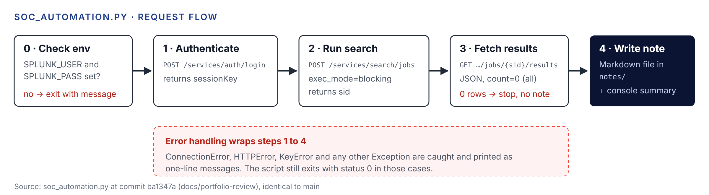

| Project ID | Purpose of this guide | Last verified |
|---|---|---|
| sec-01 | Understand the lab well enough to rebuild, extend and explain it without AI | 2026-10-26 |

**Labels.** **[Verified]** from the repo, history or screenshots · **[Inferred]** my reasoning · **[Recommended]** a suggestion. Explanations of general concepts are standard background knowledge, not claims about your project; every "Example from your project" is verified.

**Contents.** 1 Concepts This Project Teaches · 2 How the Major Components Work · 3 Why These Tools · 4 Behind the Scenes · 5 The Most Important Code · 6 How Data Moves · 7 Common Failures · 8 How an Experienced Engineer Would Approach It · 9 Interview Preparation · 10 What to Learn Next · Test Your Understanding

# 1. Engineering Concepts This Project Teaches

| Concept | Where it shows up |
|---|---|
| Windows authentication auditing | Event ID 4625 on the target |
| Log forwarding and indexing | Universal Forwarder to Splunk `index=main` |
| Detection engineering with thresholds | `where failed_logins >= 10` per five-minute bucket |
| Time bucketing and aggregation | `bucket _time span=5m` and `stats count by …` |
| REST APIs and session authentication | `/services/auth/login`, then `Authorization: Splunk <key>` |
| Synchronous versus asynchronous jobs | `exec_mode=blocking` |
| Secrets hygiene | Environment variables and `.gitignore` |
| Attack technique mapping | MITRE ATT&CK T1110, Brute Force |

# 2. How the Major Components Work

## Event ID 4625

**Beginner.** Every time someone types the wrong password, Windows writes a line in its security diary saying who tried, from where, and why it failed. That line is event 4625.

**Intermediate.** 4625 is "An account failed to log on". It carries a Subject section (the account that asked Windows to perform the logon) and a separate "Account For Which Logon Failed" section, plus Logon Type, Failure Reason, Status codes and Network Information such as Source Network Address.

**Enterprise application.** SOC teams treat bursts of 4625 events as a primary signal for password guessing and password spraying, usually correlated with 4740 (account locked out) and 4624 (successful logon).

**Example from your project.** [Verified] 81 events with EventCode 4625 came from 10.10.10.20 against `administrator`, with reason "Unknown user name or bad password." (screenshots 04 and 07).

## Splunk Universal Forwarder

**Beginner.** A small agent on the Windows machine that copies its logs to Splunk.

**Intermediate.** It reads sources declared in `inputs.conf`, tags each event with index, sourcetype and host, and sends it to the indexer over Splunk's forwarding protocol. It does almost no parsing; field extraction happens at search time on the indexer.

**Enterprise application.** Thousands of forwarders are usually managed centrally with a deployment server, with separate indexes per data type and retention policy.

**Example from your project.** [Verified] `[WinEventLog://Security]` with `index = main`.

## Threshold detection in SPL

**Beginner.** Count wrong passwords in short windows. If one computer gets it wrong 10 times in five minutes, raise an alert.

**Intermediate.** `bucket _time span=5m` rounds each event's time down to a five-minute boundary. `stats count by Account_Name, Source_Network_Address, _time` produces one row per account, source and bucket. `where failed_logins >= 10` keeps only the noisy rows.

**Enterprise application.** Production rules add a baseline (what is normal for this account or subnet), allow lists for scanners and admin hosts, and run as scheduled searches that open notable events.

**Example from your project.** [Verified] Screenshot 05 shows four buckets (03:30, 03:40, 03:45, 03:50) with 15, 16, 18 and 31 failures.

## Splunk REST API session

**Beginner.** The script logs in to Splunk like a user would, gets a temporary pass, and uses that pass for every later question it asks.

**Intermediate.** `POST /services/auth/login` returns a `sessionKey`. Later requests send it in the `Authorization: Splunk <key>` header. A search is created with `POST /services/search/jobs`; with `exec_mode=blocking` the call returns only after the search finishes, and results are read from `/services/search/jobs/{sid}/results`.

**Enterprise application.** Automation usually uses long-lived, scoped authentication tokens, normal (non-blocking) jobs with polling or the export endpoint for large results, and certificate verification against an internal CA.

**Example from your project.** [Verified] `get_session_key()`, `run_search()` and `get_results()` in `soc_automation.py`.

# 3. Why These Libraries and Tools

| Choice | Reason |
|---|---|
| Splunk | [Verified] Named purpose in the README: ingestion, search and alerting. [Inferred] Widely used in SOC job postings, so it doubles as career practice |
| `requests` | [Inferred] The standard, minimal Python HTTP client; the script needs only three calls |
| `smbclient` | [Verified] Generates real SMB authentication attempts from Kali |
| VirtualBox host-only networking | [Verified] Keeps the attack isolated from real networks |
| Markdown output | [Verified] Readable by humans, diff-able in git, and easy to paste into a ticket |

# 4. What Happens Behind the Scenes

1. `smbclient -L //10.10.10.10 -U administrator%wrongpass` opens an SMB session and attempts NTLM authentication with the wrong password.
2. Windows' Local Security Authority rejects it and writes a 4625 event. [Verified] After enough failures the account lockout policy triggers (`NT_STATUS_ACCOUNT_LOCKED_OUT`).
3. The forwarder ships the event; Splunk indexes the raw text and extracts fields when you search.
4. The script's search runs inside Splunk; only the small table of results travels back as JSON.
5. Python loops through the rows and builds the note line by line.

# 5. The Most Important Code Structures

| Function | What it does | Why it matters |
|---|---|---|
| `SPL_QUERY` | The detection logic as a string | The single source of truth for what counts as an alert in the script |
| `get_session_key()` | Logs in and returns the key | Shows API authentication |
| `run_search(session_key)` | Creates a blocking search job | Shows how search jobs work |
| `get_results(session_key, sid)` | Reads the job's results | Shows result retrieval and JSON parsing |
| `generate_case_note(alerts)` | Writes the Markdown file | Turns data into an analyst-ready artifact |
| `if __name__ == "__main__":` block | Validates env vars, runs steps, catches errors | Entry point and error policy |

[Verified] `alert.get("Account_Name", "-")` uses a default so a missing field does not crash the note.

# 6. How Data Moves Through the System

{width=100%}

Raw Windows event → forwarded event in `index=main` → aggregated row (account, source, bucket, count, severity) → JSON result → Markdown section. Each hop reduces the data: thousands of possible fields become eight values per alert.

# 7. Common Failures You Should Understand

**Double counting by account name.** [Verified] Screenshot 05 shows each bucket twice: once with `Account_Name` = `-` and once with `administrator`, with identical counts. Screenshot 07 shows the same pair. [Inferred] A 4625 event has two account name fields, the Subject (empty, shown as `-`, for network logons) and the account that failed. Splunk extracts both into one multivalue `Account_Name`, and `stats … by Account_Name` creates one row per value. The fix is to group on the target account only.

**Severity that does not match the code.** [Verified] The committed script grades 10 to 19 failures as Medium. Screenshot 07 shows 16 failures labeled High, and both committed versions of the script (a7e36cb and 5c6dd51) use the same rule. So the screenshot came from a version of the script that was never committed.

**Counts that do not add up.** [Verified] Screenshot 05 reports 81 events, while the four flagged buckets add up to 80 (15 + 16 + 18 + 31). [Inferred] One event fell in a five-minute bucket with fewer than 10 failures, so the threshold filtered it out.

**Silent failure.** [Verified] Exceptions are caught and printed, and the process exits 0, so automation cannot tell success from failure.

**Time range drift.** [Inferred] The REST search sets no time range, while the Splunk Web search used "Last 60 minutes". The two can return different results from the same data.

# 8. How an Experienced Engineer Would Approach It

- Start from a baseline of normal 4625 volume before choosing a threshold.
- Define the detection once (a saved search) and have the script call it by name, so the two copies cannot drift.
- Make failure loud: non-zero exit codes, structured logs.
- Write a small test that feeds a recorded JSON response into `generate_case_note()`.
- Treat screenshots as test evidence and regenerate them whenever the logic changes.

# 9. What You Need to Explain in a Technical Interview

1. What Event ID 4625 is and which fields matter for triage.
2. Why five-minute buckets and a threshold of 10, and what false positives that rule would produce.
3. How the forwarder, indexer and search head roles differ.
4. How the script authenticates and why credentials live in environment variables.
5. Why TLS verification is off in the lab and why that is unacceptable in production.
6. The double-count issue, how you found it, and how you would fix it.
7. How you used Claude, and what you verified yourself.
8. How this maps to MITRE ATT&CK T1110.

# 10. What to Learn Next

| Topic | Why |
|---|---|
| Event IDs 4624, 4740 and 4776 | Correlate success after failure, lockouts and NTLM validation |
| Splunk saved searches and alert actions | Turn the detection into a scheduled alert |
| Splunk authentication tokens and RBAC | Least-privilege automation |
| Python `logging`, `argparse`, exit codes | Make the script production-shaped |
| `pytest` with mocked HTTP | Test without a live Splunk |
| Password spraying (T1110.003) | A variant your current rule would miss |

# Test Your Understanding

1. Your search shows a row for account `-` beside every `administrator` row. Where does `-` come from, and how would you change the SPL?
2. If an attacker sends 9 wrong passwords every five minutes for an hour, does your rule fire? What would you add?
3. What does `exec_mode=blocking` change compared with a normal search job?
4. The script printed an HTTP error but your scheduler reported success. Why, and what is the one-line fix?
5. Why would a 4624 event from 10.10.10.20 right after these failures raise the severity?
