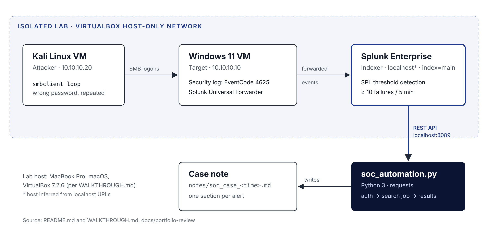

| Project ID | Repository | Code version described | Last verified |
|---|---|---|---|
| sec-01 | [splunk-bruteforce-detection-lab](https://github.com/khancam15/splunk-bruteforce-detection-lab) | `soc_automation.py` at c11e44c (`main`), identical on `docs/portfolio-review` | 2026-10-26 |

**Labels.** **[Verified]** read in the repo, history or screenshots · **[Inferred]** my reasoning from that evidence · **[Recommended]** a suggestion, not implemented.

**Contents.** 1 System Architecture · 2 Components and Dependencies · 3 API Integrations · 4 Authentication · 5 Data Flows · 6 Input and Output Structures · 7 Error Handling · 8 Logging and Monitoring · 9 Security Considerations · 10 Deployment Architecture · 11 Testing Methodology · 12 Troubleshooting · 13 Performance · 14 Future Engineering Improvements

# 1. System Architecture

{width=100%}

[Verified] Four parts: an attacker VM (Kali, 10.10.10.20), a target VM (Windows 11, 10.10.10.10) running the Splunk Universal Forwarder, a Splunk Enterprise indexer, and a Python client. The VMs share a VirtualBox host-only network; each also has a NAT adapter for package installs.

[Inferred] Splunk Enterprise ran on the Mac host, since the Splunk web UI and the script both address it as `localhost`.

# 2. Components and Dependencies

| Component | Version or setting | Source |
|---|---|---|
| VirtualBox | 7.2.6 | WALKTHROUGH.md |
| Host | MacBook Pro M5 Pro, macOS | WALKTHROUGH.md |
| Windows forwarder input | `[WinEventLog://Security]`, `disabled = 0`, `index = main` | WALKTHROUGH.md |
| Splunk Enterprise | Version not recorded | Unverified |
| Python | 3 (minor version not recorded) | README.md |
| `requests` | `>=2.31` | requirements.txt (docs branch) |
| `urllib3` | Imported directly; installed with `requests` | soc_automation.py |
| `smbclient` | Kali package, version not recorded | WALKTHROUGH.md |

# 3. API Integrations

[Verified] The script uses three Splunk REST endpoints on the management port, 8089:

| Step | Method and endpoint | Key parameters | Returns |
|---|---|---|---|
| Authenticate | `POST /services/auth/login` | `username`, `password`, `output_mode=json` | `sessionKey` |
| Run search | `POST /services/search/jobs` | `search`, `exec_mode=blocking`, `output_mode=json` | `sid` |
| Fetch results | `GET /services/search/jobs/{sid}/results` | `output_mode=json`, `count=0` | `results` array |

Timeouts: 30 s for login and results, 120 s for the blocking search.

{width=100%}

# 4. Authentication Mechanisms

[Verified] Username and password come only from the `SPLUNK_USER` and `SPLUNK_PASS` environment variables. If either is missing, the script stops before any network call. The login returns a session key, which is sent on later calls as `Authorization: Splunk <sessionKey>`.

[Verified] The first committed version (a7e36cb, 2026-04-01) fell back to `admin` and a placeholder password. The restored version (5c6dd51, 2026-10-11) removed those defaults.

[Recommended] For anything beyond a lab, use a Splunk authentication token for a least-privilege service account instead of a password and session key.

# 5. Data Flows

1. [Verified] `smbclient` on Kali attempts SMB logons to `//10.10.10.10` as `administrator` with a wrong password.
2. [Verified] Windows writes Event ID 4625 (an account failed to log on) to the Security log.
3. [Verified] The forwarder sends the events to Splunk as `sourcetype=WinEventLog:Security` in `index=main`.
4. [Verified] The SPL search filters, buckets and counts the events; the script receives the result rows as JSON.
5. [Verified] The script writes one Markdown note to `notes/` and prints a summary.

# 6. Input and Output Structures

**Detection input** [Verified]: Windows 4625 events with the fields `Account_Name`, `Source_Network_Address`, `Logon_Type`, `Failure_Reason`, `host`, `_time`.

**Search in the script** [Verified]:

```
search index=main sourcetype="WinEventLog:Security" EventCode=4625
| where NOT (Source_Network_Address="127.0.0.1" OR Source_Network_Address="::1")
| bucket _time span=5m
| stats count as failed_logins
        values(Logon_Type)     as logon_types
        values(Failure_Reason) as reasons
        values(host)           as host
  by Account_Name, Source_Network_Address, _time
| where failed_logins >= 10
| eval severity=if(failed_logins >= 20, "High", "Medium")
| sort - failed_logins
| table _time Account_Name Source_Network_Address host failed_logins logon_types reasons severity
```

The saved search in `queries/brute_force_detection.spl` is the same up to the threshold, without the extra fields, and always sets severity to High.

**Result row** [Verified]: one row per account name, source address and five-minute bucket with at least 10 failures.

**Output** [Verified]: `notes/soc_case_YYYYMMDD_HHMMSS.md` with an alert count, then one section per alert: severity, account and source in the heading; time bucket, host, account, source IP, failed logins, logon types and reasons as bullets; and three fixed recommended actions.

# 7. Error Handling

[Verified] Behavior by case:

| Case | What happens | Exit status |
|---|---|---|
| Credentials not set | Prints "Set SPLUNK_USER and SPLUNK_PASS…" | 1 |
| Splunk unreachable | Prints "Could not connect to Splunk…" | 0 |
| HTTP error (for example wrong password) | Prints the HTTP error | 0 |
| Unexpected JSON shape | Prints the missing key | 0 |
| Any other exception | Prints "Unexpected error" | 0 |
| No rows above threshold | Prints "No alerts found…", writes no file | 0 |

[Inferred] Because failures exit 0, a scheduler or CI job would treat a failed run as a success.

# 8. Logging and Monitoring

[Verified] No log file or logging framework; progress goes to standard output with `[*]`, `[+]` and `[!]` prefixes. Splunk itself provides the monitoring layer for the lab. Generated notes are ignored by git (`notes/` and `soc_case_*.md`).

# 9. Security Considerations

| Item | State | Label |
|---|---|---|
| Attack traffic confined to host-only network | Documented in SECURITY.md and WALKTHROUGH.md | Verified |
| Credentials from environment only | Implemented | Verified |
| TLS verification disabled, warnings suppressed | Implemented for the self-signed lab certificate | Verified |
| `.gitignore` covers keys, `.env`, cloud credentials, Terraform state | Implemented | Verified |
| Screenshots show lab IPs and the `administrator` account | Lab-only values, documented as acceptable | Verified |
| Branch protection and secret scanning on GitHub | Recommended in README and SECURITY.md; actual repo settings not checked | Unverified |

# 10. Deployment Architecture

[Verified] Nothing is deployed. Everything runs on one laptop: two VirtualBox VMs and a locally run Python script. The repository is the published artifact.

# 11. Testing Methodology

[Verified] Manual, evidence-based testing, recorded as screenshots. Results are as stated in WALKTHROUGH.md; I viewed screenshots 05 and 07 myself and they match.

| Check | Evidence | Result |
|---|---|---|
| Target has static IP | Screenshot 01 | 10.10.10.10 |
| Attacker reaches target | Screenshot 02 | 0% packet loss |
| Attack generates failures and lockout | Screenshot 03 | Lockout observed |
| Events ingested | Screenshot 04 | 81 failed logons from 10.10.10.20 |
| Threshold detection | Screenshot 05 | 8 rows, all High |
| Log coverage | Screenshot 06 | 376 Security events, 4625 dominant |
| Script run and note | Screenshots 07 and 08 | 2 alerts written |

[Verified] There are no automated tests and no `.github` workflows on either branch.

# 12. Troubleshooting Procedures

| Symptom | Likely cause | First check |
|---|---|---|
| "Could not connect to Splunk" | Splunk not running or 8089 not reachable | Open `https://localhost:8089` in a browser |
| HTTP 401 on login | Wrong credentials in the environment | `echo $SPLUNK_USER`; never echo the password |
| "No alerts found" | No 4625 events in the window, or below 10 per bucket | Run the SPL in Splunk Web with the same time range |
| Events missing in Splunk | Forwarder not sending | Check the forwarder service and `inputs.conf` on Windows |
| Duplicate alerts per bucket | Two account names per 4625 event | See Engineering Learning Guide, section 7 |

[Inferred] The REST search sets no time range, so Splunk applies its default. That may differ from the Splunk Web time picker, which used "Last 60 minutes" in screenshot 05.

# 13. Performance Considerations

[Inferred] Data volume is tiny (376 events in the coverage screenshot), so performance is not a concern in the lab. At production scale the unbounded time range and `index=main` search would be the first things to change: add `earliest`/`latest`, a dedicated index, and a scheduled saved search.

# 14. Future Engineering Improvements

All items below are **[Recommended]** and not implemented.

1. Fix the double count by grouping on the target account only.
2. Exit non-zero on failure.
3. Make `SPLUNK_HOST` and TLS verification configurable through environment variables.
4. Use a Splunk token for a least-privilege account.
5. Set an explicit time range on the REST search.
6. Add a correlation search for a 4624 success after the failures.
7. Add unit tests with mocked Splunk responses and a CI workflow.
8. Send the case note to a ticketing system or chat channel.
