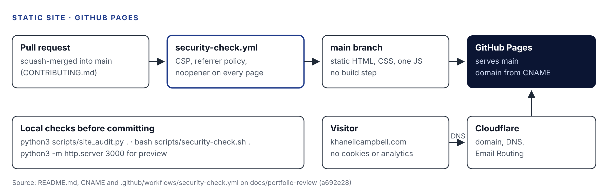

| Project ID | Category | Status | Last verified |
|---|---|---|---|
| web-01 | Web & Cloud Infrastructure | Active Development (live; redesigned 2026-10-23) | 2026-10-26 |

| Source | Location |
|---|---|
| GitHub repository | [khaneilcampbell/khaneilcampbell.com](https://github.com/khaneilcampbell/khaneilcampbell.com) |
| Live site | [khaneilcampbell.com](https://khaneilcampbell.com) |
| Local folder | Local clone on your Mac (34 commits behind `main`) |
| Related Claude conversation | None accessible |

**How to read the labels.** **[Verified]** read in the repository, its history or your local folder. **[Inferred]** my reasoning. **[Recommended]** a suggestion.

**Contents.** Project Reorientation · 1 Executive Summary · 2 Problem Statement · 3 Objectives · 4 Current Status · 5 Technology Stack · 6 Architecture · 7 Workflow · 8 Key Decisions · 9 Challenges and Solutions · 10 Limitations · 11 Next Steps · 12 Career Relevance · 13 Last Updated

# Project Reorientation

*A five-minute read to pick the project back up.*

**Where you left off.** [Verified] On 2026-10-23 and 24 you shipped the "Atelier" redesign in 31 commits: new type and brass palette, interactive architecture diagrams for both case studies, rewritten Home, About, Work and Contact copy, and NYC Health + Hospitals added to Home and About. A `docs/portfolio-review` branch (3 commits, 2026-10-24 to 25) clarifies that `_headers` is not enforced on GitHub Pages and updates repository links. It is not merged.

**What the site is.** [Verified] A static, hand-written HTML portfolio served by GitHub Pages: Home, About, Work (two full case studies and two in-progress case files), Contact, four credential pages, Privacy and a 404 page. No build step, no cookies, no analytics, no third-party requests.

**How it is built.** [Verified] One stylesheet, one first-party enhancement script, self-hosted fonts, and a strict Content Security Policy in a meta tag on every page. A GitHub Actions workflow checks the security tags on every push and pull request; two local audit scripts check more.

**What you learned.** Content Security Policy, accessible markup and contrast, SEO metadata and JSON-LD, progressive enhancement, cache-busting, and running a site through pull requests.

**What remains unresolved.**

- [Verified] `docs/PORTFOLIO-PLAN.md` lists decisions D1 to D13 still open, including whether to name Benjaire (D1) and whether to keep the in-progress case files (D9). Its "Production status" section still describes the previous design.
- [Verified] Three old branches sit on a rewritten history and share only the first commit with `main`.
- [Verified] The docs branch is unmerged; your local clone stops at 2026-10-12.

**What to work on next.** Merge the docs branch, decide D1 and D9, update the plan's status section, and add the writing section the README calls "the highest-value next step."

**Explain it without AI in one breath.** "It's a hand-built static portfolio on GitHub Pages with a strict content security policy, no third-party requests, accessible design, and automated security checks on every pull request."

# 1. Executive Summary

[Verified] Your public portfolio, positioned around AI solutions, automation, cybersecurity and enterprise systems. It hosts the case studies for the commerce pipeline (ai-01) and the Splunk lab (sec-01).

# 2. Problem Statement

[Inferred] You needed one credible place that shows your work with evidence, for recruiters and clients, without trackers or claims you cannot support. [Verified] The plan's "Verified and unverified content" table shows that evidence standard in practice.

# 3. Project Objectives

[Verified] From `docs/VISION.md` and the plan: present the work, background, credentials and direction; every claim backed by a source; fast, private and accessible.

# 4. Current Development Status

| Area | State | Evidence |
|---|---|---|
| Live site, Atelier design | Live | README "Current production"; 25 commits on 2026-10-23 |
| Case studies (ai-01, sec-01) | Live, with interactive diagrams | PR #34 |
| Phishing and access-control case files | Published as in progress | Decision D9 open |
| Benjaire case study | Not published | Decision D1 open |
| Local audits | Passing | [Verified] I ran both on 2026-10-26: 14 pages, 0 failures; 133 checks passed |
| Docs branch | Unmerged | 3 commits |
| Local copy | Out of date | 70620ef, 34 commits behind |

# 5. Technology Stack

| Technology | Role |
|---|---|
| HTML and CSS | Every page, hand-written; `assets/site.css` is the design system |
| JavaScript (`assets/site.js`) | Optional enhancement: reveals, mobile menu, diagram inspector |
| Instrument Serif and Sans | Self-hosted fonts |
| GitHub Pages | Hosting from `main` |
| Cloudflare | Domain registrar, DNS, Email Routing |
| GitHub Actions | `security-check.yml` |
| Python and Bash | `site_audit.py`, `site_inventory.py`, `security-check.sh` |
| JSON-LD | Structured data on every page except 404 |

# 6. System Architecture

{width=100%}

# 7. Workflow Explanation

1. Edit HTML or CSS locally; preview with `python3 -m http.server 3000`.
2. Run `site_audit.py` and `security-check.sh`.
3. If CSS or JS changed, recompute the content hash in the asset URLs.
4. Open a pull request; the security workflow runs; squash-merge to `main`.
5. GitHub Pages publishes; Cloudflare DNS points the domain at it.

# 8. Key Engineering Decisions

| Decision | Why (as documented) | Label |
|---|---|---|
| No build step, static HTML | Simple hosting; Astro migration considered but not started | Verified |
| CSP `default-src 'none'`, `script-src 'self'`, no inline code | No third-party origins, no network calls | Verified |
| Every page works without JavaScript | Script is enhancement only | Verified |
| Self-hosted fonts | No requests to other origins | Verified |
| Content hash on CSS and JS URLs | Stops fresh HTML pairing with a stale file in cache | Verified |
| Public résumé without phone number | Decision D6, 2026-10-14 | Verified |
| Service desk metrics removed | Owner decision: they did not fit the positioning | Verified |
| Claims must be backed by evidence | Plan section 11 | Verified |

# 9. Challenges and Solutions

| Challenge | Solution | Evidence |
|---|---|---|
| Many design directions before settling | Mist and glass (2026-10-14), then Atelier (2026-10-23) | Commit history |
| Mobile diagrams and grids broke | Fixed | 2026-10-07 commits |
| Contrast failures | Fixed in final audit | 8dff0ec |
| Stale CSS served with new HTML | Versioned asset URLs | 0956993 |
| `_headers` file does nothing on GitHub Pages | Documented on the docs branch; CSP meta tag is what is enforced | 63d3ce7 |
| Overstated claims about the pipeline | "Correct pipeline claims" | PR #6 |

# 10. Current Limitations

[Verified] From the README and plan: GitHub Pages cannot send real security headers, so policies that need headers (for example `frame-ancestors`, HSTS settings you control) are not enforced; there is no writing section, so the site ranks mainly on your name; the CI checks three tags, while fuller audits run only locally.

# 11. Next Development Steps

1. [Recommended] Merge `docs/portfolio-review`.
2. [Recommended] Decide D1 (Benjaire) and D9 (in-progress case files).
3. [Recommended] Update the plan's "Production status" to the Atelier design.
4. [Recommended] Delete the three stale branches after a last look.
5. [Recommended] Add `site_audit.py` to CI.
6. [Recommended] Start the writing section.
7. [Recommended] Pull `main` into your local clone.

# 12. Career Relevance

| Role focus | What this project shows |
|---|---|
| Web and security | CSP design, secure defaults, privacy by design |
| AI Solutions | A documented, honest record of building with Claude |
| Communication | Evidence-backed copy and case studies |

# 13. Last Updated

| Field | Value |
|---|---|
| Last verified | 2026-10-26 |
| Verified against | `main` at b6283c4 (2026-10-24) and `docs/portfolio-review` at a692e28 (2026-10-25) |
| Also read | Local folder git metadata; ran both audit scripts |
| Prepared by | Claude, for review by Khaneil Campbell |
